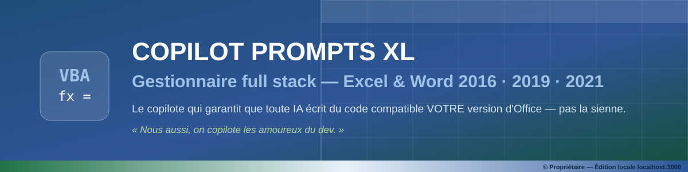
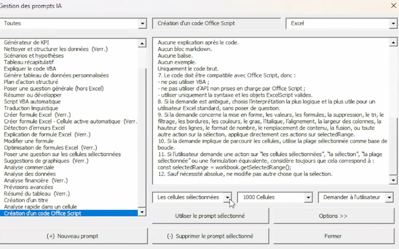
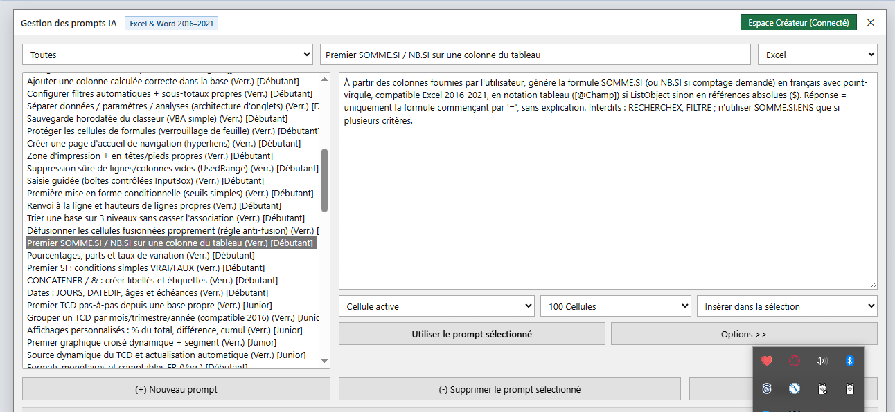
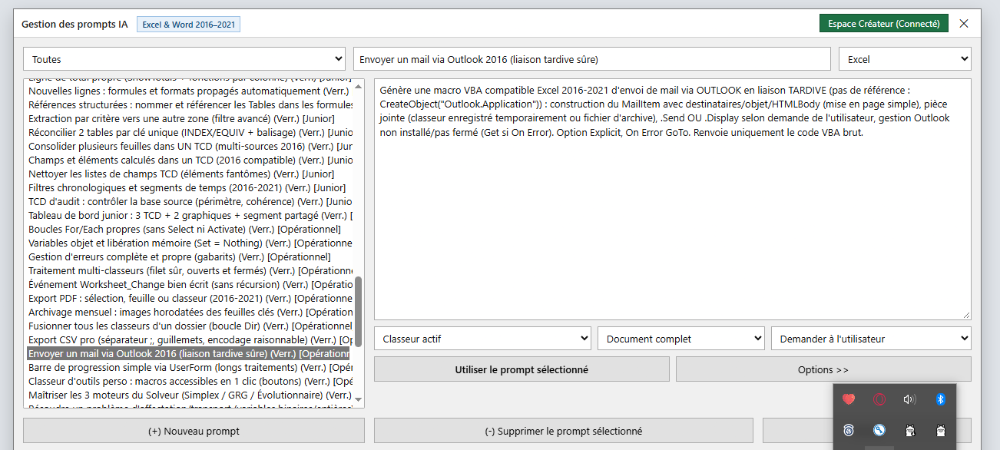

# 🚦 COPILOT PROMPTS XL — Excel & Word 2016 · 2019 · 2021



> **Le copilote qui garantit que toute IA écrit du code compatible VOTRE version d'Office — pas la sienne.**
> *« Nous aussi, on copilote les amoureux du dev. »*

<p align="center"><em>Vitrine publique du projet — le code source n'est pas livré (voir Notice de propriété).</em></p>

---

## 📖 Genèse

L'idée est née des galères répétées avec les IA génériques : **elles ne comprennent
pas la puissance d'Excel tant qu'on ne leur demande pas correctement les choses.**
Les copilotes existants ne servent que Microsoft 365 et oublient les **anciennes
générations d'Office, pourtant toujours efficaces et omniprésentes dans le monde
professionnel** — comptables, contrôleurs de gestion, PME, collectivités, cabinets…

COPILOT PROMPTS XL comble ce vide.

## 🖼️ Le modèle d'interface

Ergonomie de bureau fidèle à l'app 365, adaptée aux éditions perpétuelles :



## 📸 L'app en vrai

L'application tourne ici (captures réelles) : le copilote sert aussi bien aux
**débutants** (premier SOMME.SI, première macro propre) qu'aux profils
**opérationnels** (mails Outlook, multi-classeurs, Solveur, automatisations VBA).

| Niveau Débutant | Niveau Opérationnel |
|---|---|
|  |  |
| Somme la base *Newbiz*, 101 modèles officiels disponibles d'un clic | Compilations conformes 303/303, 100 % local, verrouillage `(Verr.)` |

**101/101 modèles chargés · 303/303 compilations conformes · 100 % local — rien ne quitte le poste.**

🎬 **[Voir la vidéo de présentation (2 min 03)](assets/demo_video.mp4)** — le parcours complet, du premier SOMME.SI au Solveur… jusqu'au grand bravo aux passionnés de l'IA.

## 💡 Le principe en 4 étapes

```
1. L'utilisateur choisit un prompt officiel (101 modèles, 7 catégories)
2. Il précise sa demande + colle ses données Office
3. Le copilote COMPILE : environnement cible / portée / limite / action /
   instructions / charte anti-M365
4. Il colle le prompt compilé dans n'importe quelle IA → code OU formule
   compatible 2016-2021 garanti
```

## 🧩 La bibliothèque officielle — **101 modèles** (objectif atteint ✅)

| Parcours | Niveau | Ce que garantit le copilote |
|---|---|---|
| **Newbiz** | Débutant | Bases de données propres (1 ligne = 1 enregistrement), saisie guidée, formules 1er niveau |
| **Junior** | Junior | INDEX/EQUIV 1-2 conditions, tables de paramètres, Tables Pro avancées, TCD complets, réconciliation par clé |
| **Opérationnel** | Opérationnel | VBA pro (boucles sans Select, multi-classeurs,Worksheet_Change, export PDF, mails Outlook, UserForm), Solveur (moteurs, affectation binaire, scénarios), Mise en valeur, Word pro |

**Recette vérifiée : 303/303 compilations conformes (101 modèles × Excel/Word 2016 · 2019 · 2021), IDs uniques, sync idempotente.**

| Spécialité | Ce que garantit le copilote |
|---|---|
| **Design & Format auto** | Macro VBA pro : polices, formats numériques/fr, largeurs, freeze panes, impression paysage |
| **Couleur codifiée** | Standard d'audit : hypothèses bleu, formules noir, liens verts, externes violets, erreurs rouge |
| **Tables Pro** | ListObject propre, en-têtes nettoyés, zébrage, ligne Total, prêt pour TCD |
| **Solveur** | SolverOk/SolverAdd/SolverSolve robuste (Simplex/GRG/Évolutionnaire) + diagnostic des erreurs |
| **TD / TCD** | TCD tabulaire + segments, tables de sensibilité 1–2 variables, tableaux de bord |
| **Formules & VBA** | Formules FR avec `;`, INDEX/EQUIV (jamais RECHERCHEX), audit VBA, synthèses Word |

## 🛡️ La charte injectée dans chaque prompt

- ✅ `Option Explicit`, gestion d'erreurs, ActiveSheet/Selection, ActiveDocument
- ✅ Formules compatibles 2016-2019-2021 (SIERREUR, SOMME.SI.ENS, INDEX/EQUIV)
- ❌ Jamais : RECHERCHEX, FILTRE, LAMBDA, Office Scripts, tout service M365/cloud
- ❌ Jamais : markdown parasite quand du code brut est demandé

## ⚙️ Sous le capot (sans en livrer le code)

| Composant | Rôle |
|---|---|
| Backend full stack local | API REST complète : CRUD, auth Admin/Dev par PIN + token, compilation, synchronisation officielle, import/export JSON |
| Base | Persistance JSON 100 % locale, autocréée — rien ne quitte le poste |
| Frontend | Interface bureau Windows/Office, 3 listes de contexte, espace créateur, verrouillage `(Verr.)` |
| Pont Office | Module VBA dans PERSONAL.XLSB / Normal.dotm : ouvre le copilote depuis le ruban Excel/Word |

## 🧭 Trajectoire

- [x] Étude intégrale des sources & gouvernance documentaire
- [x] Squelette full stack assemblé et testé (syntaxe, DOM 46/46, serveur, API, auth)
- [x] Recette fonctionnelle : 22 PASS / 0 FAIL — 54 compilations (18 × 3 versions Office)
- [x] [Bibliothèque 101/101](../bibliotheque_prompts/plan_101_modeles.md) — 3 parcours pédagogiques (Newbiz → Junior → Opérationnel)
- [x] Recette étendue : 303/303 compilations conformes, sync officielle idempotente
- [x] Registre de propriété + conformité législative (RGPD, licences, empreintes SHA-256)
- [ ] Pont VBA live + sécurité renforcée (PIN haché, expiration de token, sauvegardes)
- [ ] Sélecteur de cible IA (Claude / Mistral / GPT) adaptant le préambule compilé

## ⚖️ Notice de propriété — on ne rigole plus

> Ce dépôt est une **vitrine**. Le code source de COPILOT PROMPTS XL est
> **propriétaire et ne fait l'objet d'aucune livraison, licence ni rediffusion**.
> Le savoir-faire (modèles officiels, charte de compatibilité, mécanique de
> compilation) est verrouillé `(Verr.)` par l'espace Admin/Dev : la protection est
> structurelle, pas cosmétique.
>
> **Protection de l'œuvre** : la vidéo de présentation distribuée ici porte un
> filigrane nominal permanent (`© KRIMO765 • COPILOT PROMPTS XL • Propriété
> réservée`) et les fichiers officiels sont scellés par empreintes SHA-256
> (registre local de propriété). Toute republication non autorisée est
> identifiable et contestable.
>
> **Nous aussi, on copilote les amoureux du dev.** 💚

*© 2026 — COPILOT PROMPTS XL 2016–2021. Tous droits réservés.*
